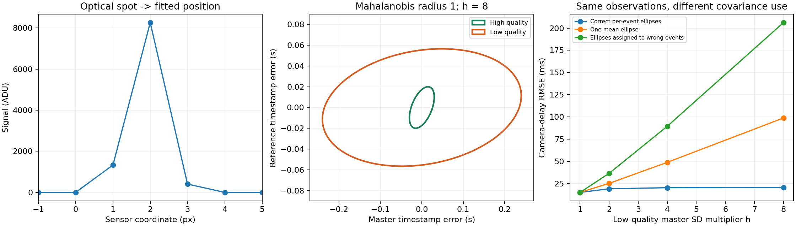

# Heteroscedastic clock errors meet optical camera timing

A 45–60 minute integrated learning lab: use a diffraction-limited spot to infer camera delay, then discover why each synchronization event needs its own uncertainty ellipse. This extends [correlated-clock calibration](https://github.com/ahmetalpkilic/correlated-clock-optical-timing-learning-lab): covariance now varies from event to event, so one generalized eigenvector fit is no longer sufficient.

## Learn and run

Prerequisites: Gaussian distributions, covariance matrices, least squares, basic Fourier optics and Python. You will derive an integrated-pixel image, recover a subpixel spot location, eliminate unknown synchronization times, and test how covariance assignment changes delay precision.

Python 3.9–3.12, a POSIX shell, and internet for the initial dependency installation:

```sh
git clone https://github.com/ahmetalpkilic/heteroscedastic-clock-optical-timing-learning-lab.git
cd heteroscedastic-clock-optical-timing-learning-lab
sh run_demo.sh
```

The one-command runner creates `.venv`, installs pinned NumPy/SciPy/Matplotlib, runs seven tests and writes `outputs/results.json` and `outputs/experiment.png`. Subsequent offline execution: `.venv/bin/python lab.py`. The default 1,000 trials at each of four noise levels take roughly a minute on a laptop; installation and test time vary. All input data are synthetic; no downloads or instruments are needed for the experiment. Checked-in reference outputs are in `examples/`.

Suggested session: 10 minutes forward model, 10 minutes likelihood derivation, 10 minutes run/inspect, 10 minutes controlled failures, 10–20 minutes exercises.

| Area | Explicit model | Connection to the measurement |
|---|---|---|
| Optics | Fourier transform of a Gaussian pupil, 550 nm wavelength | Sets the focal-plane spot width |
| Camera | 16 mm focal length, 4 µm integrated pixels, Gaussian read noise | Converts the optical spot to pixel intensities |
| Vision/metrology | Fit subpixel center and infer exposure delay along a known motion trajectory | Converts spatial localization into reference-clock time |
| Mathematics | Event-dependent correlated Gaussian errors, profile likelihood, numerical optimization | Calibrates two noisy clocks and propagates their uncertainty into delay |

## Units, coordinates and assumptions

The pupil **amplitude** is `exp(-(rho_x²+rho_y²)/a²)` with `a=1 mm`. This is an untruncated Gaussian pupil, not a uniform circular aperture or an f-number model. Wavelength is 0.550 µm, focal length 16,000 µm, pixel pitch 4 µm. Paraxial scalar Fourier optics, monochromatic isolated point imaging, zero aberration and instantaneous exposure are assumed.

The camera has square pixels, zero skew/distortion and conceptual principal point `(0,0)`: `K=diag(4000,4000,1)` in pixels. We use the horizontal marginal of the separable two-dimensional intensity. Pixel centers run from −16 to +16; positive horizontal position is rightward, and pixel j integrates `[j−0.5,j+0.5]`. This signed ROI coordinate is not a top-left image index. There is no object-depth reconstruction.

Total marginal signal is 10,000 ADU with 20 ADU background and independent 2 ADU standard-deviation Gaussian read noise per marginal sample. Width, flux and background are known. There is no Poisson noise, clipping, quantization, demosaicing or estimated photometry. This deliberately high-SNR educational setup is not a physical camera noise budget.

Master-clock time `t` and reference-clock time `r` satisfy `r=alpha*t+beta`. True `alpha=1.002` reference s/master s and `beta=0.030` reference s. Forty independent sync events have true times spanning −1 to +1 master s. Their times are **withheld from the estimator**. The camera frame tag is `T=2.0` master s; true exposure time is `T+delta`, with `delta=0.040` master s. Known trajectory `u(r)=u0+v*r`, with `u0=0.23 px`, `v=0.8 px/reference s`, supplies the optical clock reference. Clock calibration is therefore extrapolated beyond the sync interval.

For high-quality events, timestamp SDs are `sx=0.030 s`, `sy=0.020 s`, correlation `rho=0.5`. Alternating low-quality events use `sx=0.030*h`, `sy=0.020*sqrt(h)`, `rho=0.5−0.1*log2(h)`, for `h=1,2,4,8`. Each event has known positive-definite covariance `C_i` in s². Event noises are independent of one another and of camera read noise. Quality labels and covariances come from the simulator, not from estimating uncertainty on the same observations.

## Derivation: pupil to pixel to delay

The Fourier transform of `exp(−rho²/a²)` has amplitude proportional to `exp(−(pi*a*x/(lambda*f))²)`. Squaring gives Gaussian intensity with physical SD `lambda*f/(2*pi*a)`. In pixels,

```text
sigma = lambda*f/(2*pi*a*pitch) = 0.350140875 px
mu_j(u) = background + flux * [Phi((j+0.5-u)/sigma) − Phi((j−0.5-u)/sigma)]
```

`Phi` is the standard normal CDF. Fit `u` by minimizing `sum_j[(I_j−mu_j(u))/read_sd]²`, using the analytic center derivative. Pixel integration matters at this width; replacing the integral with the PSF at a pixel center changes the model.

For each observed pair `z_i=(x_i,y_i)`, latent true master time is `tau_i`:

```text
z_i = (tau_i, alpha*tau_i + beta) + epsilon_i
 epsilon_i ~ N(0,C_i)
Q = sum_i [z_i−(tau_i,alpha*tau_i+beta)]^T C_i^-1
          [z_i−(tau_i,alpha*tau_i+beta)]
```

Set `d=(1,alpha)` and `q_i=(x_i,y_i−beta)`. Differentiation in `tau_i` gives the weighted projection

```text
tau_i* = (d^T C_i^-1 q_i)/(d^T C_i^-1 d).
```

Substitution leaves a two-parameter profile objective, with normal vector `n=(−alpha,1)`:

```text
v_i(alpha) = n^T C_i n = alpha² C_i,xx − 2 alpha C_i,xy + C_i,yy
Q(alpha,beta) = sum_i (y_i−alpha*x_i−beta)² / v_i(alpha)
w_i(alpha) = 1/v_i(alpha)
beta*(alpha) = sum_i w_i(alpha)*(y_i−alpha*x_i) / sum_i w_i(alpha).
```

We numerically minimize `Q(alpha,beta*(alpha))`. Weights change with the slope: a single weighted vertical least-squares solve is not equivalent. This is a **functional** errors-in-variables likelihood with fixed unknown event times. The Gaussian normalization `log det C_i` is constant; there is **no added `log v_i` term**. Integrating random latent times would define a different likelihood and require a prior/distribution for those times.

The implementation centers coordinates, checks a 65-point grid over the declared physical rate interval `[0.5,1.5]`, refines each detected interior local minimum, and chooses the smallest objective. A boundary optimum or nearly flat direction raises an error. This finite grid is not a general global-optimum proof; a dense independent grid and full latent-event solver validate the lesson's cases.

Finally the spot center provides `r_hat=(u_hat−u0)/v`, hence

```text
delta_hat = ((u_hat−u0)/v − beta_hat)/alpha_hat − T.
```

Small perturbations obey

```text
d(delta) ≈ du/(v*alpha) − d(beta)/alpha − (T+delta)*d(alpha)/alpha.
```

The long lever arm `T+delta` explains why uncertainty in clock rate can dominate precise optical localization. Joint rate/offset correlations matter; the demo uses Monte Carlo propagation rather than adding scalar error bars in quadrature.

## Annotated implementation

- `optics.py`: `SIGMA` links the pupil to the sensor; `image` integrates the PSF; `derivative` and `fit_center` recover the subpixel position.
- `lab.py`: `covariances` generates event-specific ellipses; `profile` eliminates offset and latent times; `calibrate` performs the checked scalar search; `latent_times` reconstructs weighted projections for validation; `delay_from_center` ties clock calibration back to optics.
- `test_lab.py`: independent pupil FFT and pixel quadrature, homogeneous generalized-eigenvector special case, full 42-parameter latent-event least squares, dense objective search, unit/translation/permutation invariance, independent-seed precision experiment and invalid/boundary inputs.

## Controlled errors and expected outputs

All three estimators receive exactly the same noisy timestamps and fitted camera centers. Only their assumed covariance differs:

1. **Per event:** use the correct `C_i` for every observation.
2. **Pooled:** replace all ellipses with the mean covariance. This discards which events are reliable.
3. **Misassigned:** shift the ellipse array one event, giving high weights to low-quality events and vice versa.

At `h=1` all covariances are identical and all methods must agree. As heterogeneity grows, the per-event method should retain more precision. Averaging covariance is not guaranteed to introduce bias; loss of precision is the intended lesson. Individual runs still have random error even under the correct model. See the numerical table below, generated from the fixed seed.

The figure shows the pixel-integrated spot, two distinct error ellipses and the delay RMSE sweep. Ellipse contours have Mahalanobis radius 1 (about 39.3% probability in two dimensions), **not** 68% joint coverage. JSON reports bias, sample SD, RMSE and Monte Carlo standard error of the mean bias. MCSE describes simulation estimation error, not an instrument confidence interval.

| SD multiplier h | Correct per-event RMSE (ms) | Pooled RMSE (ms) | Misassigned RMSE (ms) |
|---|---:|---:|---:|
| 1 | 15.131 | 15.131 | 15.131 |
| 2 | 19.197 | 25.299 | 36.599 |
| 4 | 20.431 | 48.954 | 89.527 |
| 8 | 20.629 | 98.861 | 206.173 |

Noiseless delay recovery: **40.0000004 ms**. Camera-center SD across 1,000 noisy image fits: **0.0002689 px**. At h=8, correct-model mean delay error is **−0.750 ms**, with **0.652 ms MCSE**; this does not establish a nonzero systematic bias. The pooled fit has **+1.897 ms** mean error and **3.127 ms MCSE**. Repeated outputs are deterministic with the pinned environment; floating-point/platform changes may alter final digits.



## Exercises

1. Change pixel pitch from 4 to 2 µm while holding physical optics fixed. Update `K` and interpret the changed spot width in pixels. Keep the motion convention explicit: a fixed physical velocity would also change pixels/s.
2. Replace integrated pixels with center samples, then measure noiseless center bias over pixel phase. Explain how that bias enters delay.
3. Move the frame time inside the sync interval. Predict and measure how reduced clock extrapolation affects delay RMSE.
4. Change the assignment of high-quality events so they cluster near `t=0`. Compare clock-rate precision with the same number of high-quality events spread across the interval.
5. Implement a full joint fit over `alpha,beta,tau_i`. Reproduce the profile result, then deliberately add `log v_i` and explain why that changes the statistical model.

## Limitations and next step

This lab assumes known covariance matrices, independent events, affine clocks, known optics/trajectory and one isolated spot. Covariance estimation uncertainty, shared event drift, outliers, finite exposure, unknown velocity and timing nonlinearity are excluded. The numerical rate search is restricted to `[0.5,1.5]`; it is not a generic arbitrary-slope regression library. Numerical recovery and synthetic repeatability do not establish instrument accuracy, traceability or coverage.

Next focused extension: finite-sample uncertainty in the timestamp covariance estimates, using independent calibration repeats and checking the stability of the optical delay estimate. This will relax today's known-ellipse assumption rather than repeat the homogeneous-clock lesson.

## Sources and license

Original new calibration/experiment code and synthetic outputs: MIT. `optics.py`, the first two optical tests, runner and dependency pins reuse/adapt the MIT [correlated-clock predecessor](https://github.com/ahmetalpkilic/correlated-clock-optical-timing-learning-lab) at `e5550bed0313c3f3bebe8cccb8ad7369e6a811af`, copyright 2026 ahmetalpkilic; its license is retained in `licenses/`. New work replaces the homogeneous eigensolver with event-dependent profiling and a new sensitivity experiment.

Reviewed current [prysm](https://github.com/brandondube/prysm) (MIT) for optical modeling context, [SciPy least_squares](https://docs.scipy.org/doc/scipy/reference/generated/scipy.optimize.least_squares.html) for independent validation, and active NumPy/SciPy/Matplotlib repositories. No prysm code or external datasets are copied. NumPy and SciPy carry BSD-3-Clause notices; Matplotlib has its own permissive license agreement. Installed distributions retain their bundled third-party notices. `sources.json` pins reviewed current commits, activity dates, license URLs and local text snapshots; these source-review commits are distinct from the runtime versions pinned in `requirements.txt`.
